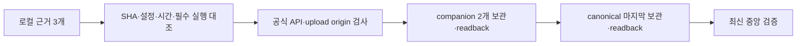

# TC-SERVICE-ARCHIVE-R2-v1

## 목적과 범위

승인 설계 `TC-SDK100-SERVICE-EVIDENCE-v1`/PR228을 유지하면서 PR230의 두 번째 리뷰에서 재현한 보관 도구 결함을 수정한다. 게임·SDK·서버 API·운영 설정은 추가 변경하지 않는다. 운영 원장은 Obsidian `프로젝트/platform/`에 유지하고 이 문서는 승인·인수조건 연결점으로 사용한다.

기준 후보는 `19ecfc061b55db77b4e6fe0da3567b19880dc5d7`이다. 이 후보의 실제 서버 검사626개·fail/skip0과 최신 중앙 local/remote before-build PASS는 유효한 과거 실행으로 보존한다. 수정 이후 새 SHA에 이 결과를 복사하지 않고 최종 main에서 실제 서비스 실행·보관·중앙 검증을 다시 수행한다.

## 재현과 사용자 영향

두 번째 PR230 리뷰의 [최초 URL 인증](https://github.com/seorilabs/platform/pull/230#discussion_r4259621286)과 [새 보관본 일치 검사](https://github.com/seorilabs/platform/pull/230#discussion_r4259621361)를 수용한다.

1. `request()`에 허용되지 않은 HTTPS origin을 전달하면 거부 없이 Authorization을 붙여 요청한다. 회귀 재현에서는 네트워크를 가로채고 합성 토큰만 사용했다. 실제 외부 전송·비밀값 노출 사고를 확인한 결과는 아니다.
2. 정상 canonical에 다른 source SHA의 runtime-result를 섞거나 필수 테스트 이벤트를 제거해도 새 업로드 분기가 성공한다. 재현은 실제 통과 근거를 복사한 임시 파일과 가상 GitHub 저장소에서 수행했다. 실제 draft 자산을 변경하지 않았다.
3. 기대는 네트워크/업로드 전 거부이며 현재 3개 회귀 검사가 모두 실패한다. 재현 도구와 red 원본은 `/private/tmp/tc-service-e2e-results/archive-review2-repro.py`, `archive-review2-red.log`에 보존한다. 이는 보관 도구 결함 재현이며 실제 제품 E2E로 세지 않는다.

기존 canonical 재사용 분기에 추가한 검사가 첫 업로드에는 빠져 같은 보관 영역에서 결함이 반복됐다. 불일치 근거가 빌드 판단에 쓰이는 것을 막기 위해 공통 검증을 업로드 이전으로 이동한다.

## 수정 책임과 흐름

- `archive_service_evidence.py`: 최초 인증 요청은 `https://api.github.com`과 `https://uploads.github.com`의 기본 HTTPS origin만 허용한다. userinfo·다른 포트·fragment·비HTTPS·scheme-relative URL은 요청 전에 거부한다. 자산 download의 HTTPS redirect는 현재와 같이 다른 origin으로 Authorization을 넘기지 않는다. 오류에 토큰이나 URL 쿼리를 출력하지 않는다.
- 공통 보관본 검사: canonical filename/source/e2e source, runtime source·설정 지문·계획/시작/완료 시각·raw digest·canonical runtime 참조를 대조한다. 필수 테스트의 실제 pass, fail/skip0, 실행 이벤트 허용 필드, runtime 선언 counts와 이벤트 관측 counts의 일치를 검사한다. 새 업로드와 기존 보관본 readback 모두 같은 검사 함수를 사용한다.
- 도구·테스트만 변경한다. 표준 라이브러리를 사용하고 새 패키지·토큰·운영 권한·공개 SDK 자산은 만들지 않는다. 기존 canonical을 덮어쓰지 않으며 누락·불일치·불명확한 원격 결과는 실패로 유지한다.

## 인수조건과 재검증

| ID | 조건 | 검사 |
|---|---|---|
| AC-R2-ORIGIN | 허용되지 않은 최초 URL에는 인증 요청을 보내지 않음 | 합성 URL/토큰 red→green, 공식 API/upload 허용, cross-origin redirect 인증 제외 |
| AC-R2-BUNDLE | 새 보관/기존 재사용 모두 동일한 실제 실행 근거만 수용 | SHA·지문·시각·참조·counts 불일치, 필수 이벤트 누락·skip/fail·추가 Output 거부와 정상 보관 회귀 |
| AC-R2-RELEASE | 실제 최종 main 근거로만 빌드/배포를 진행 | 최종 CI, 서비스 E2E, 최신 중앙 before-build/before-deploy, 6대상 이미지/readiness 실제 readback |

수정 후 회귀 검사와 기존 검사, 최종 main의 실제 서비스 실행을 수행한다. UI가 없는 서버이므로 새 GUI 회차는 없다. 실제 제공자·실기기·실거래·광고 표시·게임 앱 활성화·마켓 제출은 포함하지 않는다.

## 리뷰·승인과 운영

사용자는 PR229·230에서 Balanced 선택 완료를 알렸으나 실제 두 번째 결과는 모두 `Review effort: Lite`였다. PR별 요청2회 상한을 소진했고 세 번째 요청은 하지 않는다. 이 차이를 그대로 기록하고 작성자의 자체 점검·회귀·중앙 검증을 근거로 사람의 병합/운영 판단을 받는다. PR229 SSV suffix 지적은 제품의 `acceptsAdUnit`/`adUnitSuffix`와 실제 HTTP 성공 근거로 소명했다.

`seori-pr-workflow`의 “2회차에도 같은 영역에서 실패 시나리오가 있는 결함이 나오면 … 설계 재검토를 사람에게 확인한다” 규칙에 따라 이 버전의 수정 설계와 실제 Lite 대체 결과를 사람에게 확인받는다. 승인 전에는 새 보관 코드 수정·병합·production 승인을 하지 않는다.

승인할 범위는 이 두 결함의 최소 수정·회귀·중앙 검증, 현재 두 PR의 리뷰2회 처리 결과 기록, 기존 승인 범위의 squash 병합·운영 배포다. 추가 코드 리뷰/GUI/SDK 재발행/마켓 작업은 없다. 배포 실패 시 실제 파이프라인 상태와 기존 이미지 근거를 보존하고 기존 복구 절차를 따른다.

- 설계 요청 버전: `TC-SERVICE-ARCHIVE-R2-v1`
- 추적: PR228 원 승인, [실행 티켓231](https://github.com/seorilabs/platform/issues/231), [서버 PR229](https://github.com/seorilabs/platform/pull/229), [배포 PR230](https://github.com/seorilabs/platform/pull/230)
- 상태: red 재현3건 완료, 제품·보관 코드 추가 수정 전, 이 버전 사람 승인 대기
