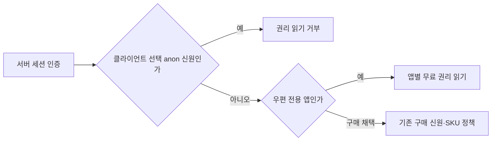

# 무료 우편의 인증·카탈로그 경계 재검토

현재 서버 후보는 운영 반영하지 않는다. 로컬 코드 리뷰 2회차에서 같은 영역의 실제 결함 두 개를 확인했으므로, 기존 구현과 별도인 이 수정 설계를 검토받는다. UI5·6·7, 기기 사용이나 추가 코드 리뷰 회차를 늘리는 문서가 아니다.

## 재현과 수정 범위

1. `Session.EnsureNotAnonymous`는 서명된 Firebase 익명 사용자와 클라이언트가 고른 `anon:` 신원을 구분한다. 새 무료 읽기 분기가 이 검사를 생략해 사칭 가능한 세션도 허용했다. 인증 직후 이 검사를 적용하고, 서명된 Firebase 익명 세션의 무료 읽기만 허용한다. 구매·계정 참조는 기존 정책을 유지한다.
2. Admin 우편 allowlist 읽기는 기능 플래그를 통과해도 뒤의 SKU 교집합 검사에서 막혔다. 우편 전용 앱은 형식이 유효한 registry allowlist만 읽고, 구매 앱은 기존 SKU 교집합 검사를 유지한다. IAP 지급·회수 권한이나 우편 발행 권한을 넓히지 않는다.
3. 앞서 고친 우편 원장과 마켓 worker 분리, 앱·사용자·production/sandbox 격리도 회귀 검사한다. 임시로 iap를 켜거나 SKU를 만드는 방법은 사용하지 않는다.

인수조건은 클라이언트 선택 anon 권리 읽기403, Firebase 서명 익명 무료 읽기200, 구매·계정 참조403, 구매 앱의 기존 익명·연결 계정 정책 유지, SKU 없는 우편 allowlist 읽기 성공, 일반 IAP mutation 거부, 앱·환경 간 권리 비혼합이다. 실제 서비스 CI의 전체 17기능 회귀와 단위·HTTP 경계·에뮬레이터 검사를 연결한다. 변경된 UI는 없고 기기도 사용하지 않는다. 추가 로컬 모델 리뷰는 돌리지 않으며 이미 쓴 두 회의 원본과 실패를 보존한다.

## 앱 연결과 운영 적용 범위

대상 앱은 `my-little-parasite`, Firebase 프로젝트 `my-little-parasite`(145282129130), GA4 속성564191533이다. Android 구매는 false이고 무료 선물 권리만 읽는다. 새 장기 비밀키를 만들지 않는 `platform-auth@my-little-parasite.iam.gserviceaccount.com`을 생성한다. 기존 credential 백업·양쪽 복원 검증 후 등록하고 아래 앱 범위만 적용한다.

| 대상 | 적용할 권한·범위 |
|---|---|
| platform-api 런타임 SA | 위 앱 SA 리소스의 `roles/iam.serviceAccountTokenCreator` |
| 실제 platform-worker Job 런타임 SA | 등록된 배포 identity로 실제 주소를 읽어 확인한 뒤 위 앱 SA의 같은 역할. 주소를 추정해 바인딩하지 않음 |
| 앱 SA | 이 Firebase 프로젝트의 `roles/firebaseauth.admin`, `roles/datastore.user`, `roles/serviceusage.serviceUsageConsumer`; GA4 속성564191533의 Editor |
| worker BigQuery | 실제 삭제 collector의 기존 권한을 먼저 확인. 앱의 `analytics_564191533` 데이터셋이 생긴 경우에만 필요한 앱 데이터 삭제 범위를 검토하며, 공유 프로젝트 전체 권한을 새로 부여하지 않음 |

Token Creator는 JWT 서명만이 아니라 access token 발급도 포함한다. Firestore IAM은 컬렉션별로 좁힐 수 없어 데이터 사용자 역할은 이 앱 프로젝트로 한정한다. 실제 사용자 데이터 삭제, 운영자 우편 발행, 실제 보상 지급과 기기 실행은 포함하지 않는다. Firebase Auth·Firestore 규칙·기존 upload 인증서·GA4 앱 연결은 이미 해당 앱에서 확인했으며, 이 승인으로 다른 앱·키·계정에 변경하지 않는다.

수정·자체 검사·필수 CI가 끝난 별도 Ready PR을 병합하고 공유 서버의 기존 여섯 배포 대상에 같은 검증된 이미지로 반영한다. CI 환경 검토가 남으면 이 승인 범위에서 처리하되 승인·이미지·배포·readback을 구분한다. 전역 registry를 검증한 뒤 이 앱 파일 하나만 regsync로 반영한다. 공개 config와 권리·인증 경계를 확인하며 실패 시 로컬 돌봄과 저장을 유지한다. 사용자 데이터 복구·삭제나 광범위 권한 확대가 필요하면 멈춘다.

## 승인 요청 근거

[seori-pr-workflow/SKILL.md](/Users/syous/.codex/skills/seori-pr-workflow/SKILL.md)는 “2회차에도 같은 영역에서 실패 시나리오가 있는 결함이 나오면 … 설계 문제로 보고 PR 분할이나 설계 재검토를 사람에게 확인한다”고 요구한다. 같은 자리의 검사를 계속 고치거나 3회차 모델 리뷰를 반복하지 않고, 이 범위를 승인받은 뒤 수정한다. 기존 특정 이미지의 운영 배포 승인을 이 새 서버 변경과 새 앱 SA 생성에 재사용하지 않는다.
